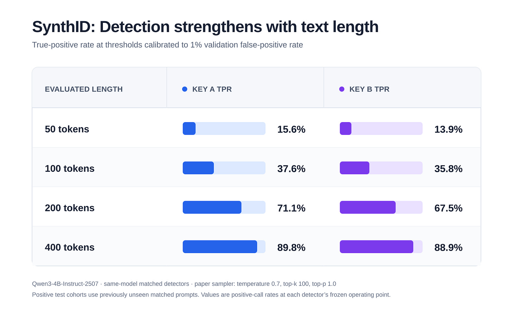
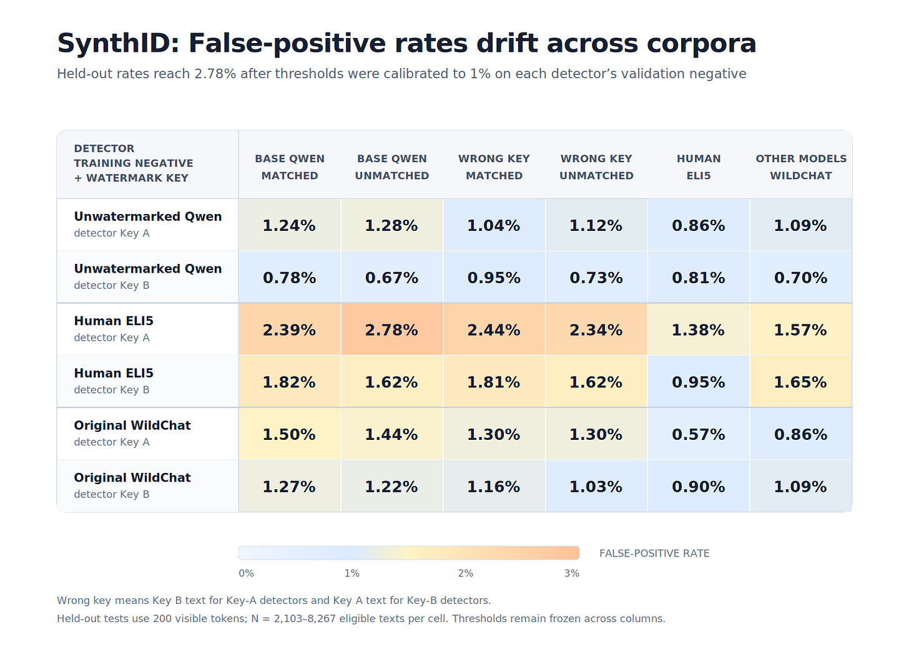
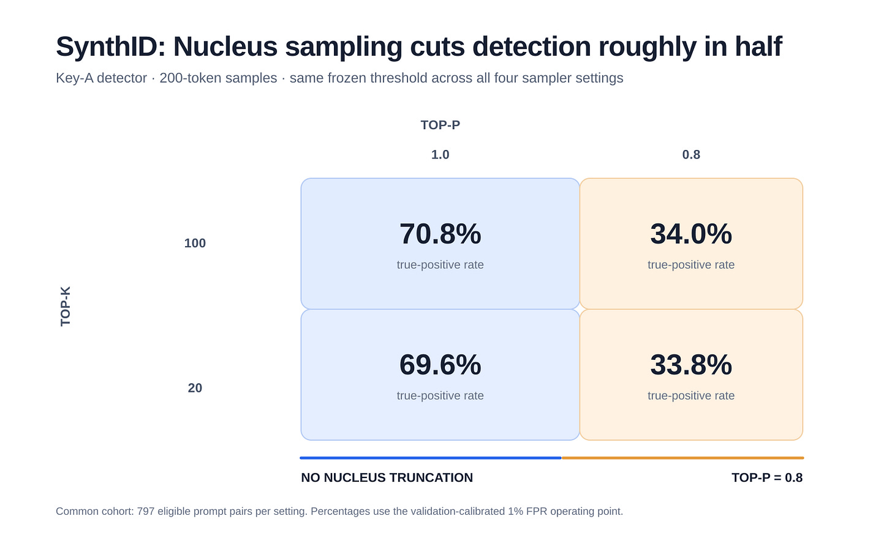
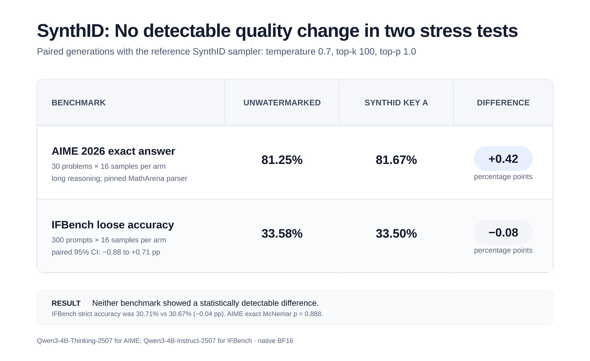
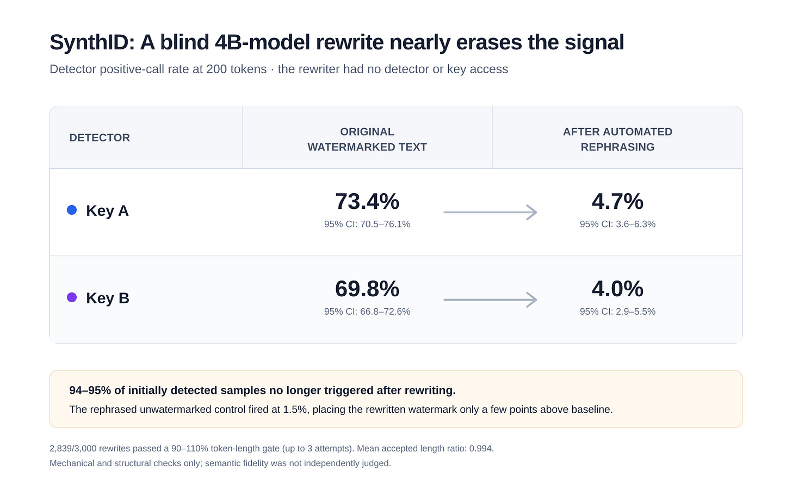

# Exploring SynthID AI watermarks

*Evaluating the AI watermark method Anthropic plans to deploy*

*Originally published on [xlr8harder.substack.com](https://xlr8harder.substack.com/p/exploring-synthid-ai-watermarks), 2026-08-18. This is a mirror.*

---
Anthropic recently announced they would begin watermarking Claude’s output in order to comply with EU regulation intended to make AI output detectable. Anthropic will adapt a [method first shared by Google called SynthID](https://www.nature.com/articles/s41586-024-08025-4). The markings will be applied worldwide whenever supported models are used. We don’t know exactly what Anthropic’s implementation of SynthID will look like, but we can explore the version of SynthID that Google described in their paper.\
\
There are five questions I set out to answer:

- How reliable is SynthID?

- Do users notice SynthID?

- Does SynthID affect quality?

- Can SynthID be used to identify specific users?

- Is SynthID adversarially robust?

Let’s get started.

Thanks for reading Unoptimized! Subscribe for free to receive new posts and support my work.

### What is SynthID?

Language models generate text one token at a time by producing a probability distribution over next possible tokens. SynthID modifies the sampling process so that token choices become weakly correlated with a secret key and the preceding context.

The SynthID detector reconstructs the same modifications that would have been used during generation, and measures whether the tokens in the text contain more watermark-favored choices than expected by chance.

Each individual token carries very little evidence, but detection becomes more reliable as evidence accumulates over a longer passage.

[Anthropic’s post has some more detail.](https://www.anthropic.com/news/claude-text-watermark)

### Method

An open source implementation of SynthID for text is already available in HuggingFace transformers. For scalable inference, I ported SynthID watermarking to a vLLM custom logits processor, and verified that despite the different backend implementations, the resulting probability distribution matches with a maximum absolute per-token probability difference of less than 1e-6.

I generated responses using Qwen3-4B-Instruct-2507 and Qwen3-4B-Thinking-2507 at native BF16 precision, including unwatermarked results, and two watermarked sets, generated using keys I will call Key A and Key B.

The main WildChat-based corpus contains 120,000 responses: 40,000 per watermarking configuration, and includes a matched prompt set as well as a mutually disjoint unmatched prompt set.

The code, generated corpus, experiment keys, and trained detectors can all be found starting from [my GitHub repository](https://github.com/xlr8harder/synthid).

### Is SynthID reliable?

We don’t know about the exact implementation Anthropic will use. Google reports detection as the true positive rate at a fixed false-positive rate, usually 1%, with the threshold selected using a negative validation set.

Using Qwen, I reproduced the Google’s basic length-dependent behavior. Using detectors trained against unwatermarked output from the same model, I obtained:

In addition to the detectors described above, trained with negative samples from unwatermarked Qwen responses, I also created detectors using negative samples from:

- human-written ELI5 answers (as in the Google paper)

- original responses from other models in WildChat

Across these detectors, 200-token true positive rates on the matching key ranged from about 67-75%. False-positive rates on unwatermarked Qwen, the wrong watermark key, human ELI5 text, and original WildChat responses were generally close to 1%, though occasionally approaching nearly 3%.

This shows the detector is key-specific and reasonably transferable, but it also shows why it’s important to know both the detector’s training distribution and the negative set used to calibrate its threshold.

#### Sampling parameters matter

The most notable result came from changing the sampler.

The SynthID paper used `top_k=100` without `top_p` or `min_p `truncation. Qwen’s recommended configuration for the 4B instruct model is temperature `0.7`, `top_k=20`, and `top_p=0.8`.

SynthID is applied after top-k and top-p filtering. Those filters remove the lower-probability candidates from the distribution before the watermark is applied. That reduces the effective freedom the watermark has to adjust the text.

In a matched setting using 200 token samples, using the same frozen key-A detector:

Different sampling parameters roughly halved the true positive rate.

This raises the question of whether providers will need to constrain the sampling option exposed to users in order to reliably deploy SynthID watermarking.

### Do users notice SynthID?

Google’s paper says that users don’t obviously prefer one to another. In a production A/B experiment using aggregate thumbs-up/thumbs-down rates, they saw no significant difference in preference for unwatermarked responses. Likewise, in a separate controlled preference study used paired responses to 3,000 ELI5 questions, they also did not find a statistically significant difference. These results seem plausible from my data, and I didn’t notice any obvious differences during manual inspection.

Across 20,000 matched responses, average completion lengths were similar:

- unwatermarked: 928.6 tokens,

- key A: 932.1 tokens,

- key B: 932.7 tokens.

Word-frequency and punctuation also showed no conspicuous differences.

### Does SynthID affect quality?

Google reports no significant degradation across human ratings, perplexity, or its automatic benchmarks. I also tested two settings that seemed particularly capable of exposing small token-selection errors.

AIME 2026 requires long mathematical reasoning trajectories. I ran it 16 times and averaged the results. Qwen generated an average of 21,000 tokens per response. The scores were not significantly different.

- unwatermarked: 81.25%

- key A: 81.67%

- difference: +0.42 percentage points

IFBench tests output generation under precise constraints. Across 30 problems with 16 paired generations per problem, the scores were not significantly different.

IFBench loose accuracy:

- unwatermarked: 33.58%

- key A: 33.5%

- difference: -0.08 percentage points

Strict IFBench accuracy differed by only -0.04 percentage points.

### Can SynthID be used to identify specific users?

There are generally claims that SynthID can’t fingerprint specific users. This is, at best, incomplete. What SynthID can’t easily do is fingerprint *every* user.

My experiment demonstrates the simplest case: Key A and Key B are distinguishable. A Key-A detector usually treated Key-B text like other negative text, and vice versa.

This doesn’t mean that every user can be uniquely identified, however. Each detector is tuned to one key, and has a small false positive rate. A naive implementation means that to identify a user, you’d need to check any text snippet against every used detector, and fairly quickly reliable signal is overwhelmed by false positives. For a trivial example, with 100 detectors each with a 1% independent false positive rate, the probability that at least one detector fires would be 63%.

But there are ways to improve that performance, using metadata, more complex detector strategies, or—more straightforwardly—by collecting more or longer samples per user, all of which would make attribution easier.

And a straightforward and troubling option, easily done today, is that a provider could easily assign a special key to a small cohort, such as a particular geographic region.

### Is SynthID adversarially robust?

No. It is easy to strip watermarks from the generated text.

Anthropic acknowledges that a complete rewrite can remove the watermark, but presents this as a laborious human editing task. That understates the practical weakness, and it’s a weakness that Google explicitly acknowledges in their paper: LLM paraphrasing. In my experiment, a blind unwatermarked 4B model performed the rewrite automatically, without special access to the watermark key or detector, and reduced detection almost to the false positive rate.

I gave 3,000 responses to an unwatermarked copy of the same unwatermarked 4B Qwen model instructions to rephrase each response while preserving its structure and details. I kept responses within 90-110% of the source token length, with up to 3 retries, which left me with 2,839 accepted responses.

Here is what that did to the detection rates:

I did not vet these samples for quality, but this nonetheless demonstrate the basic method: a trivial rewrite with a small 4B model reduced detection to only a few percentage points above the false-positive rate.

### How does SynthID compare with the alternatives?

If the goal is to reliably make AI text detectable, I think watermarking methods like Google’s reference SynthID implementation are the wrong solution.

While I was unable to detect any quality issues introduced by SynthID, the true positive “AI detection” rate in the reference SynthID implementation seems lower than would be desired, while introducing an avenue for privacy risk. It’s also not meaningfully resistant to automatic methods to remove watermarks.

General AI detectors like Pangram do not rely on watermarking, but on naturally occurring statistical patterns in AI generated text. There are also various countermeasures to Pangram’s approach, but as of today, Pangram appears substantially more difficult to evade, and accomplishes this while introducing no new risk to privacy.

Thanks for reading Unoptimized! Subscribe for free to receive new posts and support my work.
