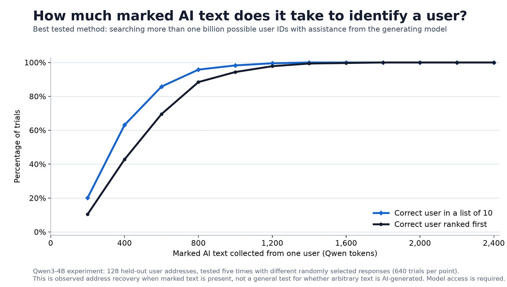
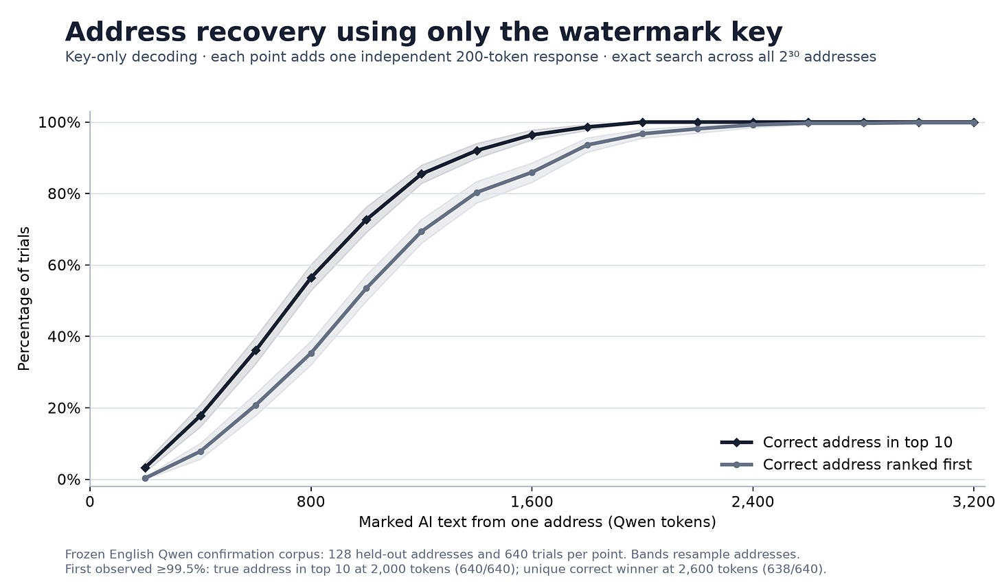
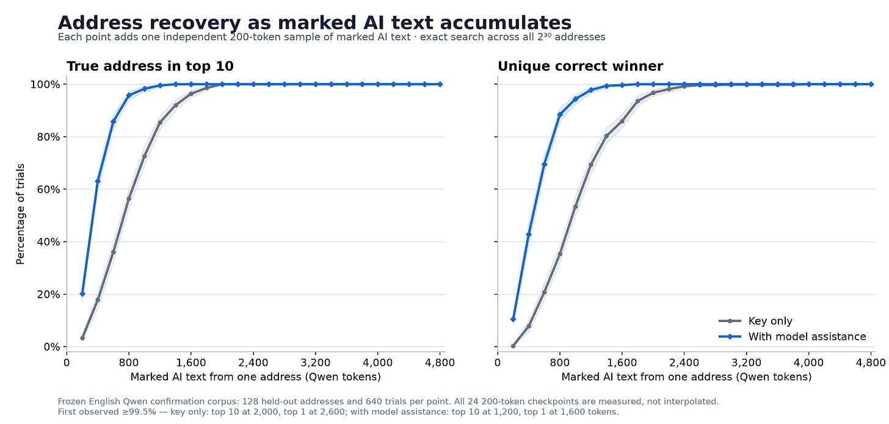
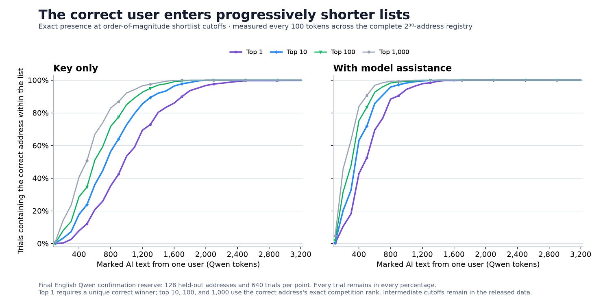
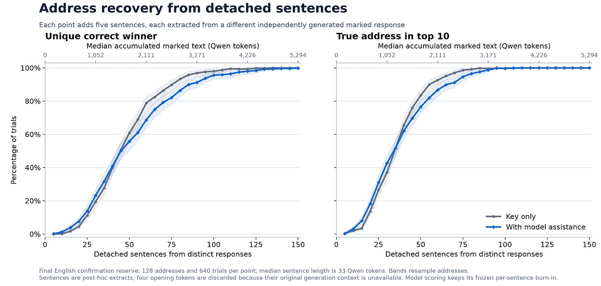
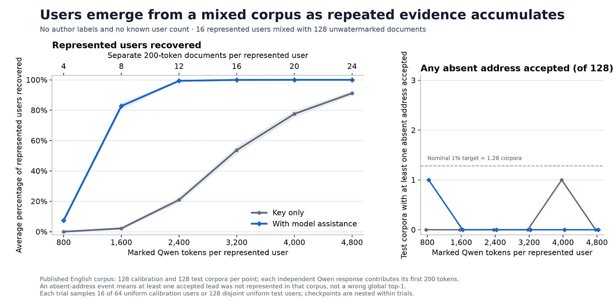
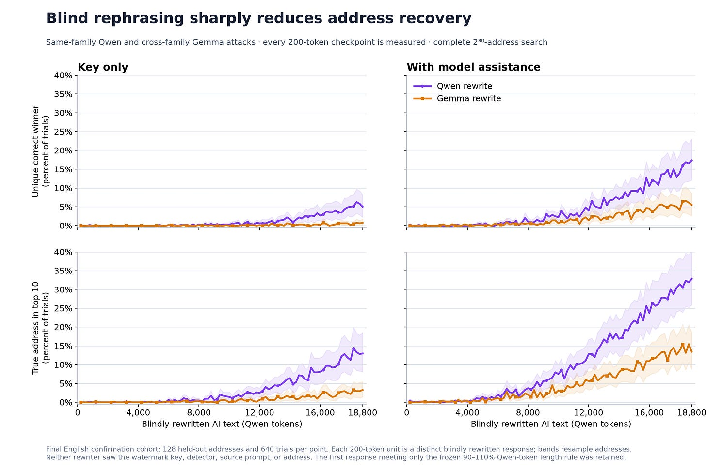

# TrellisMark: I Built the Thing Everyone Said AI Watermarking Wouldn't Be Used For

*Can we uniquely fingerprint a billion users with AI text watermarking?*

*Originally published on [xlr8harder.substack.com](https://xlr8harder.substack.com/p/trellismark-i-built-the-thing-everyone), 2026-08-23. This is a mirror.*

---
The main thing I came to appreciate while [exploring SynthID](https://substack.com/home/post/p-211726207) (the watermark that major AI labs are using to make AI generated text detectable) was that existing AI watermarking methods were sufficient to reliably encode quite a lot of metadata into AI generated text.

This made me wonder if it would be possible to use such a system to identify individual users. SynthID supports different watermarking keys, but its published detector tests one supplied key at a time. Attributing a sample across many keys would therefore require a separate check for each key. Each detection check also has a false-positive rate, so successfully searching many keys would require an approach that manages that.

As published, SynthID was not designed to scale to many distinct keys. But its watermark channel looks to have enough capacity to carry a large user identifier directly. So how difficult would it be to build a large scale watermark surveillance system?

It was not very difficult.

Most of the required elements are already in the watermarking literature. What was missing was an assembly optimized for one operational goal: efficient attribution across a very large address space.

I want to be clear: I don’t think such a system should be used. I don’t even think it should be legal to broadly deploy. But people should understand that it is possible. Publishing a working example makes the risks concrete and gives countermeasure research something testable. (More on that at the end.)

**NOTE:** To the best of my knowledge, **no one has announced an intention to deploy a system like this**. The point of this post is to demonstrate how straightforward it is to build attribution for individual users, using techniques already published today.

### Introducing TrellisMark

I designed TrellisMark around a few operational requirements that would make attribution useful in realistic investigative circumstances.

- Billion-address scale: support a large address space that can be searched completely and efficiently at detection time

- Modest evidence requirements: recover an address from a few thousand marked tokens accumulated across multiple independent posts.

- Progressive attribution: produce increasingly short candidate lists as evidence accumulates.

- Secret-gated decoding: using TrellisMark’s evidence to recover an identifier or determine that documents carry the same identifier requires the provider’s key

Here’s a compact technical description of how that is achieved (feel free to skip this part): TrellisMark is a multi-bit, many-user text watermark that encodes a 30-bit user address as a convolutionally coded radix-4 watermark carried by SynthID-style token tournaments, then aggregates soft token-level evidence and uses Viterbi decoding to recover and rank candidate addresses efficiently across the full address space. In a real deployment, the provider would maintain the mapping between these addresses and user accounts.

TrellisMark is probably not very close to an ideal implementation. I’m not an expert in watermarking, and even I see opportunities for improvement beyond what I present here. But I think it is enough to demonstrate the principle, which is the purpose of the experiments that follow.

The method draws on a lot of existing work, and there is a list of relevant papers at the end, as well as a reference implementation. I plan a follow up post where I go into more of the technical detail about how this works, because I think it’s worthwhile to understand.

Subscribe to receive the technical follow up and articles about other things I find interesting.

### TrellisMark performance

I tested TrellisMark with output from Qwen3-4B-Instruct-2507. Models vary in how much watermark information they can carry, but Qwen3-4B was not an outlier among the 8 models and model variants I probed for capacity.

The decoder searches all 2^30 valid addresses without enumerating them, with linear runtime in the requested shortlist size. The recovery rates below were measured using text from 128 uniformly sampled addresses. I saw comparable performance when I performed separate tests with a deliberately awkward block of 32 consecutive low-numbered addresses.

Basic key-only address recovery. For reference, a standard printed page is about 250 words or 400 Qwen tokens.

To generate the graph above, for each of 128 user addresses, I repeated a trial five times. In each trial, I randomly selected a collection of that user’s independently generated 200-token response prefixes (prompted with a cleaned subset of WildChat), for a total of 640 trials at each marked token amount. With 2,000 tokens, the correct address appeared in the top 10 list in all 640 trials. With 2,600 tokens, the correct address ranked first in 638 of 640 trials. These were the first measured points at which top-10 and top-1 accuracy reached at least 99.5%.

An important thing to note here is that the watermark does not require tokens to be from a single document in order to accomplish user attribution. Documents can be collected from AI text shared by the user over time, and used collectively to recover the address assigned to the user. There are some tradeoffs around document length, but they do not change this fundamental dynamic.

And we can improve this initial result. The TrellisMark key detector is small and efficient. What if we were willing to spend a little more compute on the problem?

### I would simply use better priors

If a user has shared some watermarked AI text, but not enough to produce a practical shortlist, we can replay the text through the model that generated it and ask how strongly each observed token supports each of the four watermark symbols. The key-only detector treats much of this token evidence similarly; model replay tells us which observations were truly informative given the alternatives available to the model. This adapts the white-box soft-symbol approach used by QuantileMark to TrellisMark’s SynthID-style tournament sampling mechanism.

Using the model that generated the text enabled substantially more efficient recovery

Under the same test settings, using the originating model to strengthen the soft evidence via six global weights fitted on separate development data and frozen before this evaluation, we can identify users with substantially fewer tokens. In these 640 trials, observed top-10 recovery first reached at least 99.5% at 1,200 tokens, compared with 2,000 for key-only scoring. Observed top-1 recovery first reached at least 99.5% at 1,600 tokens, compared with 2,600.

Another way to present performance is to follow the correct address’s rank as more marked text accumulates. The graph below shows how often the correct address appears in a selection of top-N lists as evidence accumulates.

More watermarked data moves the correct user address into shorter and shorter attribution lists.

To underscore that document size is not a critical limiting factor, here’s an extreme document size case: single sentences taken from different documents. The total number of tokens required for reliable attribution is increased, but attribution is still possible.

Attribution is still possible using single sentence documents

### Mixed attribution settings

In a real deployment, we wouldn’t always know which observed text is watermarked by our method, and sometimes we wouldn’t even be confident how many users were involved.

I ran some tests under a harder “open-corpus” setting, meant to approximate anonymous message-board posts without author labels. Each simulated corpus was constructed from marked posts contributed by 16 users, mixed with 128 unwatermarked model outputs. At each point on the curve, every marked user contributed the same number of 200 token posts, varying from 4 to 24 posts per user across the experiment. These details are not supplied to the detector.

The detector received only the resulting unlabeled pool of documents. It was not told how many users were represented or which documents belonged together. It had to find groups carrying consistent watermark evidence, recover their addresses, and reject addresses absent from the corpus. A false lead means that the detector confidently assigned an inferred group of documents to an address belonging to none of the users actually represented in the corpus.

Attribution is still possible in the open corpus setting

Initial results suggest this simplified version of the open-corpus problem is tractable. There is a large design space to explore for this kind of problem: clustering, joint refinement, peeling, and calibration, so this should be read only as a baseline, and I would expect that improvements are readily available.

### Countermeasures

I said above that I didn’t think a method like TrellisMark should be deployed, but that understanding how it works is important for building countermeasures. So let’s talk about countermeasures.

Of course, the two most important countermeasures are not technical tricks: prefer to publish text from models that you control, and work to outlaw deployment of a system like this.

But let’s look at the technical solutions, too.

### Black box detection

Black box detection methods are used to detect whether a model endpoint is watermarking its outputs, without giving the detector access to the watermark key. [Gloaguen et al](https://arxiv.org/abs/2405.20777). developed tests targeting several watermark families. In one preliminary experiment, an adapted Red-Green test detected watermark-related sampling bias on a TrellisMark endpoint, although I used a matched unwatermarked Qwen endpoint for calibration. More exploration is needed to determine how well this works under less favorable conditions.

I would like to spend more time on this.

### Watermark removal

Though an end user without the watermark key can’t easily tell which specific tokens carry watermark signal, we can broadly rewrite a document to strip most of the signal. Automated rephrasing is easy, but stripping all of the signal is less so: two small local models, told to rephrase watermarked text, each strip most of the signal from the output, but leave some residual.

Some identification capability remains after simple automated rephrasing

The residual signal is likely carried forward in part due to small phrases and fragments that are kept across the rewrite, and in a brief analysis of the rephrased documents there was a correlation between exact 5 token sequences retained after rewriting and the residual attribution score (5 token sequences are relevant to TrellisMark’s synchronization mechanism.)

So the simplest version of this only removes most of the watermark signal (and further, I did not perform a substantive quality evaluation of the rewritten samples.) It looks both straightforward and worthwhile to optimize the rewriting process to further reduce or eliminate the signal while maintaining document quality.

### Closing

If you made it this far, I hope I have convinced you that:

1.  individual watermarking at a scale suitable for broad surveillance is technically possible;

2.  systems like this should not be deployed; and

3.  if they are deployed, their use should be detectable and their watermarks reliably removable.

If you’d like to learn more about the technology that enables AI watermarking like this, I plan a technical writeup about the implementation in the near future, which you can subscribe below to receive.

Subscribe to receive the technical follow up and articles about other things I find interesting.

## Resources and References

A reference implementation is available, as well as watermarked and unwatermarked data I generated for development and used for the graphs above.

- [TrellisMark reference implementation](https://github.com/xlr8harder/trellismark)

- [TrellisMark sample dataset](https://huggingface.co/datasets/xlr8harder/trellismark-qwen3-4b)

- [TrellisMark sample subset for open corpus setting](https://huggingface.co/datasets/xlr8harder/trellismark-qwen3-4b-open-corpus)

TrellisMark is largely an assembly of existing techniques, turned toward determining whether surveillance watermarking is technically feasible. Its primary contribution is in the way in which it combines existing components. A non-exhaustive list of the most relevant preexisting work is included below. Forgive me if I’ve missed something important: this is not my area.

- [QuantileMark: A Message-Symmetric Multi-bit Watermark for LLMs, Zhu, Huang & Wan (2026)](https://aclanthology.org/2026.acl-long.308/)\
  Perhaps the most technically similar published method. Our optional model-assisted decoder adapts QuantileMark’s basic teacher-forced soft-symbol approach, but applies it to a different sampling mechanism and combines it with convolutional coding and full-registry Viterbi ranking.

- [Scalable Watermarking for Identifying Large Language Model Outputs, Dathathri et al. (Nature, 2024)](https://www.nature.com/articles/s41586-024-08025-4)\
  This paper introduces SynthID-Text. We use its context-dependent tournament sampling and token-level watermark evidence.

- [Advancing Beyond Identification: Multi-bit Watermark for Large Language Models, Yoo, Ahn & Kwak (2024)](https://aclanthology.org/2024.naacl-long.224/)\
  We draw on MPAC’s approach of allocating generated tokens among payload positions and representing the payload with radix-r symbols.

- [Improving Data Hiding by Using Convolutional Codes and Soft-Decision Decoding, Hernández, Delaigle & Macq (2000)](https://doi.org/10.1117/12.384985)\
  Early image-watermarking precedent for decoding convolutionally coded payloads from soft evidence with Viterbi. TrellisMark applies this established pattern to token-level evidence and full-registry address ranking.

- [Watermarking Language Models for Many Adaptive Users, Cohen, Hoover & Schoenbach (IEEE S&P 2025)](https://arxiv.org/abs/2405.11109)\
  Theoretical background for multi-user tracing, adaptive prompting, and collusion.

- [Watermark-based Attribution of AI-Generated Content, Jiang et al. (ICLR 2026)](https://proceedings.iclr.cc/paper_files/paper/2026/hash/ad77a15531fbccefa8be5e434b4b7908-Abstract-Conference.html)\
  Closest prior work to the overall goal, in the image domain: give users distinct watermarks, search a registry, and attribute content to the best match.

- [Black-Box Detection of Language Model Watermarks, Gloaguen et al. (ICLR 2025)](https://arxiv.org/abs/2405.20777)\
  Source of the Red-Green black box test adapted for the preliminary detection experiment used in this post.
